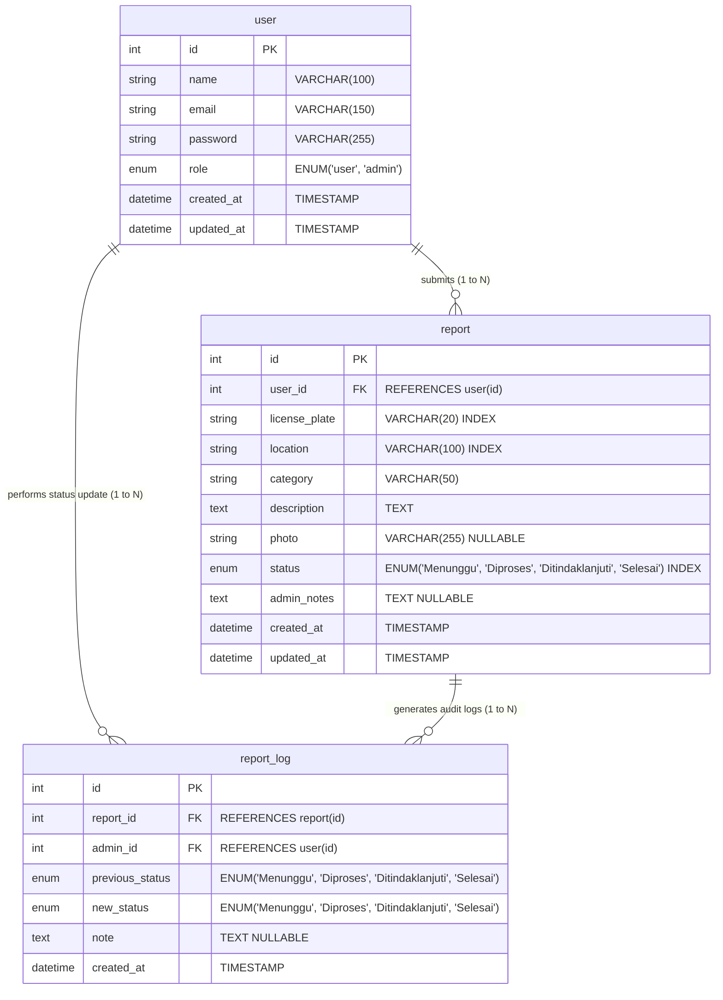

# Data Model Specification - ParkirTertib

## 1. Entity-Relationship (ER) Diagram



## 2. Table Specifications

### Table: `user`
Stores account credentials and role authorization levels.

| Column | Data Type | Nullable | Key / Index | Default | Description |
|---|---|---|---|---|---|
| `id` | `INT UNSIGNED` | No | PK | Auto-increment | Unique user account ID |
| `name` | `VARCHAR(100)` | No | - | - | Full name of user |
| `email` | `VARCHAR(150)` | No | Unique | - | Account email address |
| `password` | `VARCHAR(255)` | No | - | - | Bcrypt hashed password |
| `role` | `ENUM('user', 'admin')` | No | - | `'user'` | Role permission level |
| `created_at` | `TIMESTAMP` | No | - | `CURRENT_TIMESTAMP` | Record creation timestamp |
| `updated_at` | `TIMESTAMP` | No | - | `CURRENT_TIMESTAMP ON UPDATE CURRENT_TIMESTAMP` | Record update timestamp |

### Table: `report`
Stores submitted parking violation details, current status, and attached image reference.

| Column | Data Type | Nullable | Key / Index | Default | Description |
|---|---|---|---|---|---|
| `id` | `INT UNSIGNED` | No | PK | Auto-increment | Unique report ID |
| `user_id` | `INT UNSIGNED` | No | FK | - | User ID of reporter (`user.id`) |
| `license_plate` | `VARCHAR(20)` | No | Index | - | Normalized vehicle plate (e.g. `BK1234ABC`) |
| `location` | `VARCHAR(100)` | No | Index | - | Campus parking area location |
| `category` | `VARCHAR(50)` | No | - | - | Type of violation |
| `description` | `TEXT` | No | - | - | Incident description |
| `photo` | `VARCHAR(255)` | Yes | - | `NULL` | Filename in `public/uploads/` directory |
| `status` | `ENUM('Menunggu', 'Diproses', 'Ditindaklanjuti', 'Selesai')` | No | Index | `'Menunggu'` | Current processing state |
| `admin_notes` | `TEXT` | Yes | - | `NULL` | Latest note added by Satpam |
| `created_at` | `TIMESTAMP` | No | - | `CURRENT_TIMESTAMP` | Submission timestamp |
| `updated_at` | `TIMESTAMP` | No | - | `CURRENT_TIMESTAMP ON UPDATE CURRENT_TIMESTAMP` | Last status update timestamp |

### Table: `report_log`
Audit log tracking each status transition performed by Satpam officers.

| Column | Data Type | Nullable | Key / Index | Default | Description |
|---|---|---|---|---|---|
| `id` | `INT UNSIGNED` | No | PK | Auto-increment | Unique audit log ID |
| `report_id` | `INT UNSIGNED` | No | FK | - | Associated report ID (`report.id`) |
| `admin_id` | `INT UNSIGNED` | No | FK | - | Satpam user ID (`user.id`) |
| `previous_status` | `ENUM('Menunggu', 'Diproses', 'Ditindaklanjuti', 'Selesai')` | No | - | - | Status prior to update |
| `new_status` | `ENUM('Menunggu', 'Diproses', 'Ditindaklanjuti', 'Selesai')` | No | - | - | Updated status |
| `note` | `TEXT` | Yes | - | `NULL` | Action notes or stiker warning details |
| `created_at` | `TIMESTAMP` | No | - | `CURRENT_TIMESTAMP` | Audit log timestamp |

## 3. Database Schema Migration Script (`schema.sql`)

```sql
-- Database Initialization Schema for ParkirTertib
CREATE DATABASE IF NOT EXISTS `parkir_tertib` DEFAULT CHARACTER SET utf8mb4 COLLATE utf8mb4_unicode_ci;
USE `parkir_tertib`;

-- Drop existing tables
DROP TABLE IF EXISTS `report_log`;
DROP TABLE IF EXISTS `report`;
DROP TABLE IF EXISTS `user`;

-- 1. Table: user
CREATE TABLE `user` (
  `id` INT UNSIGNED NOT NULL AUTO_INCREMENT,
  `name` VARCHAR(100) NOT NULL,
  `email` VARCHAR(150) NOT NULL,
  `password` VARCHAR(255) NOT NULL,
  `role` ENUM('user', 'admin') NOT NULL DEFAULT 'user',
  `created_at` TIMESTAMP NOT NULL DEFAULT CURRENT_TIMESTAMP,
  `updated_at` TIMESTAMP NOT NULL DEFAULT CURRENT_TIMESTAMP ON UPDATE CURRENT_TIMESTAMP,
  PRIMARY KEY (`id`),
  UNIQUE KEY `uk_user_email` (`email`)
) ENGINE=InnoDB DEFAULT CHARSET=utf8mb4 COLLATE=utf8mb4_unicode_ci;

-- 2. Table: report
CREATE TABLE `report` (
  `id` INT UNSIGNED NOT NULL AUTO_INCREMENT,
  `user_id` INT UNSIGNED NOT NULL,
  `license_plate` VARCHAR(20) NOT NULL,
  `location` VARCHAR(100) NOT NULL,
  `category` VARCHAR(50) NOT NULL,
  `description` TEXT NOT NULL,
  `photo` VARCHAR(255) DEFAULT NULL,
  `status` ENUM('Menunggu', 'Diproses', 'Ditindaklanjuti', 'Selesai') NOT NULL DEFAULT 'Menunggu',
  `admin_notes` TEXT DEFAULT NULL,
  `created_at` TIMESTAMP NOT NULL DEFAULT CURRENT_TIMESTAMP,
  `updated_at` TIMESTAMP NOT NULL DEFAULT CURRENT_TIMESTAMP ON UPDATE CURRENT_TIMESTAMP,
  PRIMARY KEY (`id`),
  KEY `idx_report_user` (`user_id`),
  KEY `idx_report_status` (`status`),
  KEY `idx_report_license_plate` (`license_plate`),
  KEY `idx_report_location` (`location`),
  CONSTRAINT `fk_report_user` FOREIGN KEY (`user_id`) REFERENCES `user` (`id`) ON DELETE CASCADE
) ENGINE=InnoDB DEFAULT CHARSET=utf8mb4 COLLATE=utf8mb4_unicode_ci;

-- 3. Table: report_log
CREATE TABLE `report_log` (
  `id` INT UNSIGNED NOT NULL AUTO_INCREMENT,
  `report_id` INT UNSIGNED NOT NULL,
  `admin_id` INT UNSIGNED NOT NULL,
  `previous_status` ENUM('Menunggu', 'Diproses', 'Ditindaklanjuti', 'Selesai') NOT NULL,
  `new_status` ENUM('Menunggu', 'Diproses', 'Ditindaklanjuti', 'Selesai') NOT NULL,
  `note` TEXT DEFAULT NULL,
  `created_at` TIMESTAMP NOT NULL DEFAULT CURRENT_TIMESTAMP,
  PRIMARY KEY (`id`),
  KEY `idx_log_report` (`report_id`),
  KEY `idx_log_admin` (`admin_id`),
  CONSTRAINT `fk_log_report` FOREIGN KEY (`report_id`) REFERENCES `report` (`id`) ON DELETE CASCADE,
  CONSTRAINT `fk_log_admin` FOREIGN KEY (`admin_id`) REFERENCES `user` (`id`) ON DELETE CASCADE
) ENGINE=InnoDB DEFAULT CHARSET=utf8mb4 COLLATE=utf8mb4_unicode_ci;

-- Initial Seed Data
-- Passwords are hashed representation of 'Password123!'
INSERT INTO `user` (`id`, `name`, `email`, `password`, `role`) VALUES
(1, 'Satpam Utama', 'satpam@unimed.ac.id', '$2y$10$e8R45VbF.O4V0q0sQkR9U.rN8fP7lU2/k5P3P6B6N.9I9O9P9Q9S.', 'admin'),
(2, 'Ahmad Student', 'ahmad@mhs.unimed.ac.id', '$2y$10$e8R45VbF.O4V0q0sQkR9U.rN8fP7lU2/k5P3P6B6N.9I9O9P9Q9S.', 'user');
```

> **Catatan implementasi:** hash di atas adalah placeholder; `schema.sql` di repo memakai
> hash bcrypt valid hasil `password_hash('Password123!')`. Tidak ada migrasi pasca-MVP:
> notifikasi (FR-008) membaca `report.status`/`updated_at` yang ada, cleanup manual (FR-009)
> memakai `report.photo`, dan waktu tampil dinormalisasi ke WIB di lapisan aplikasi (D-015).

## 4. Post-MVP Notes (No Migration Required)

* **Notifications (FR-008):** derived from the existing `report` table; no new tables or columns.
* **Manual cleanup (FR-009):** reuses `report.photo`; no schema change.
* **Timestamps:** stored as server time, rendered WIB-normalized at the application layer (D-015).